<div align="center">

# RAGNav

**Hybrid, structure-aware retrieval for RAG: BM25 + embeddings + document-graph expansion, with page routing and cross-reference following for long PDFs. Runs fully offline; no API key required.**

[](https://pypi.org/project/ragnav/)
[](https://pypi.org/project/ragnav/)
[](https://pepy.tech/projects/ragnav)
[](https://github.com/irfanalidv/RAGNav/actions/workflows/ci.yml)
[](https://github.com/irfanalidv/RAGNav/actions/workflows/codeql.yml)
[](https://github.com/irfanalidv/RAGNav/blob/main/LICENSE)
[](https://github.com/astral-sh/ruff)
[](https://mypy-lang.org/)
[](https://github.com/irfanalidv/RAGNav/blob/main/CONTRIBUTING.md)

</div>

## Why RAGNav?

Chunk-and-embed RAG loses the structure of a document: chunks cut across sections, "see Table 2" never matches Table 2, and the answer comes back without saying where it lives. RAGNav keeps documents as a graph of blocks (headings, paragraphs, captions, messages, clauses) with typed edges, retrieves with BM25 and local embeddings fused by reciprocal rank fusion, and expands hits along that structure so the evidence is coherent and traceable to a page and block id. The common path is `pip install` plus sentence-transformers: no vector database, no API key, reproducible offline benchmarks.

On **SQuAD** (500 validation questions, fully offline), hybrid RAGNav reaches **R@3 = 0.956**, ahead of BM25-only (0.932) and embedding-only (0.906). Reproduce with `python benchmarks/squad_benchmark.py`.

## Features

| Feature | What it does |
| ------- | ------------ |
| Hybrid retrieval | BM25 (`rank-bm25`) + sentence-transformers embeddings, fused with RRF (or weighted min-max) |
| Structure expansion | Adds parent headings and child blocks to each hit (`expand_structure=True`) |
| Graph expansion | Walks typed edges (`next`, `reply_to`, `link_to`, ...) from each hit (`expand_graph=True`) |
| Paper mode | PDF -> headings / paragraphs / captions with page anchors; page routing, then retrieval inside routed pages, then `link_to` cross-reference following (Figure / Table / Section / Appendix) |
| Multi-format ingest | Markdown, PDF, HTML, email (`.eml`), Slack-style chat, numbered legal text |
| Confidence | Every `RetrievalResult` carries `HIGH` / `MEDIUM` / `LOW` plus a normalized top score |
| `QueryFallback` | On LOW / MEDIUM confidence, retries with LLM-written rephrasings and keeps the better result |
| Inline citations | `answer_with_inline_citations` returns sentences ending in `[[block_id]]` and validates every citation |
| Filters and ACLs | Restrict by doc id, page, document metadata, or `principal` against doc / block ACLs |
| Guardrails | `SimpleInjectionPolicy` drops prompt-injection blocks and redacts secret-like strings |
| Entity GraphRAG | Lexicon-based entity graph with multi-hop retrieval and provenance |
| Reranking | Optional cross-encoder second stage (`CrossEncoderReranker`) |
| Caching, cost, tracing | SQLite embedding / retrieval cache, `CostTracker` with `budget_usd`, `Trace` timings |
| Offline evaluation | `EvalCase` / `score_retrieval`, SQuAD and CUAD benchmarks, one-command scorecard |
| CLI | `ragnav paper-pdf`, `hybrid-pdf`, `vectorless-pdf`, `agentic-pdf` |

Typed (`py.typed`, mypy-clean with `disallow_untyped_defs`).

## Install

```bash
pip install ragnav                    # BM25 + structure/graph retrieval (numpy, rank-bm25)
pip install "ragnav[embeddings]"      # + sentence-transformers for hybrid retrieval (recommended)
pip install "ragnav[pdf]"             # + PyMuPDF and requests for PDF ingest
```

With [uv](https://docs.astral.sh/uv/): `uv add "ragnav[embeddings]"`.

Other extras: `messy` (HTML via beautifulsoup4), `reranking` (cross-encoder), `mistral` (Mistral chat / embeddings client), `all` (everything except `mistral`), `dev`. Requires Python 3.10+.

## Quickstart

Hybrid retrieval, no API key (`pip install "ragnav[embeddings]"`; downloads `all-MiniLM-L6-v2` once):

```python
from ragnav import RAGNavIndex, RAGNavRetriever
from ragnav.ingest.markdown import ingest_markdown_string

doc, blocks = ingest_markdown_string(
    "Paris is the capital of France.",
    name="demo.md",
)
index = RAGNavIndex.build(
    documents=[doc],
    blocks=blocks,
    use_sentence_transformers=True,
    vector_model="all-MiniLM-L6-v2",
    embed_batch_size=32,
)
retriever = RAGNavRetriever(index=index)
result = retriever.retrieve(
    "What is the capital of France?",
    top_k=5,
    expand_structure=False,
    expand_graph=False,
)
print(result.blocks[0].text)  # Paris is the capital of France.
print(result.confidence)  # ConfidenceLevel.HIGH
```

BM25-only works with the base install and no model download: pass `build_vectors=False` to `RAGNavIndex.build` and `use_vectors=False` to `retrieve`. `result.blocks` lists the best hit first, followed by the parent headings and children added by structure expansion.

### Long PDFs and papers

`PaperRAG` routes the query to likely pages, retrieves inside them, and follows `link_to` edges to referenced figures, tables, sections, and appendices. The LLM is used to write the answer; embeddings stay local by default. Needs `pip install "ragnav[pdf,mistral]"`, `MISTRAL_API_KEY`, and network access to download the PDF:

```python
from ragnav.llm.mistral import MistralClient
from ragnav.net import download_pdf
from ragnav.papers import PaperRAG, PaperRAGConfig

llm = MistralClient()
cfg = PaperRAGConfig(max_pages=25, top_pages=4, follow_refs=True)

pdf_bytes = download_pdf("https://arxiv.org/pdf/2507.13334.pdf")
paper = PaperRAG.from_pdf_bytes(pdf_bytes, llm=llm, pdf_name="paper.pdf", cfg=cfg)
print(paper.answer("What experiments were conducted?", cfg=cfg))
# answer_cited: every sentence ends in [[block_id]]
print(paper.answer_cited("What does Figure 1 show?", cfg=cfg))
```

Or from the shell:

```bash
ragnav paper-pdf --pdf-url "https://arxiv.org/pdf/2507.13334.pdf" --query "What is Context Engineering?"
```

<details>
<summary>Other CLI modes and example output</summary>

```bash
ragnav hybrid-pdf     --pdf-url "https://arxiv.org/pdf/2507.13334.pdf" --query "What is Context Engineering?"
ragnav vectorless-pdf --pdf-url "https://arxiv.org/pdf/2507.13334.pdf" --query "What is Context Engineering?"
ragnav agentic-pdf    --pdf-url "https://arxiv.org/pdf/2507.13334.pdf" --query "Summarize the paper's main contribution."
```

All four take `--cache-db path.sqlite` to cache embeddings and retrievals; `vectorless-pdf`, `hybrid-pdf`, and `paper-pdf` also take `--print-hits` to dump the retrieved evidence as JSON.

Paper-mode demo (`python3 examples/papers/ragnav_paper_rag_pdf.py --pdf-url "https://arxiv.org/pdf/2507.13334.pdf" --pdf-name "2507.13334.pdf" --max-pages 25`), trimmed output:

```text
## Routed pages
- doc_id=pdf:2507.13334.pdf page=4 score=0.5423 N=3
- doc_id=pdf:2507.13334.pdf page=14 score=0.5298 N=7
- doc_id=pdf:2507.13334.pdf page=9 score=0.4662 N=4
- doc_id=pdf:2507.13334.pdf page=5 score=0.4597 N=3
```

</details>

## Architecture

```mermaid
flowchart LR
    subgraph ingest["ragnav.ingest"]
        direction TB
        MD[markdown]
        PDF[pdf / pdf paper-mode]
        HTML[html]
        EML[email]
        CHAT[chat]
        LEGAL[legal]
    end

    ingest --> G["Blocks + typed Edges<br/>(BlockGraph: parent, next,<br/>link_to, reply_to, ...)"]
    G --> IDX["RAGNavIndex.build<br/>BM25Index + VectorIndex<br/>(sentence-transformers or llm.embed)"]

    subgraph retrieve["RAGNavRetriever.retrieve"]
        direction TB
        S1[BM25 search] --> F[Fusion: RRF or weighted]
        S2[Vector search] --> F
        F --> FL[Filters: doc ids, pages,<br/>metadata, ACL principal]
        FL --> RR[Optional CrossEncoderReranker]
        RR --> C[Confidence HIGH / MEDIUM / LOW]
        C --> XS[expand_structure] --> XG[expand_graph] --> P[content_policy]
    end

    IDX --> retrieve
    P --> RES[RetrievalResult<br/>blocks, confidence, trace]

    RES --> UP["PaperRAG / pipelines / QueryFallback<br/>answer_with_inline_citations"]
    CACHE[(SQLite EmbeddingCache<br/>RetrievalCache)] -.-> IDX
    CACHE -.-> retrieve
```



`retrieve_paper()` runs the same retrieval after `route_pages_by_semantics` picks the top pages, then follows `link_to` edges. `EntityGraphRetriever` (GraphRAG) is a separate path over an entity graph built from the same blocks.

Key design decisions:

- **Blocks and edges, not chunks.** Every ingester emits blocks with anchors (page, line range, URL, timestamp) and typed edges, so provenance and coherence come from the document itself rather than from chunk overlap.
- **Rank fusion over score mixing.** BM25 and cosine scores live on different scales; RRF combines rank positions and needs no per-corpus weight tuning. With a single contributing list, its own scores are kept so confidence still reflects match strength.
- **Deterministic expansion.** Structure and graph expansion are rule-based and keep the hits' relevance order (best hit first), so results are reproducible and can be truncated safely.
- **Offline by default, LLM optional.** Indexing and retrieval need no LLM. Clients implement a two-method `LLMClient` protocol (`chat`, `embed`); `MistralClient` and `FakeLLMClient` ship with the package.

## Use cases and recipes

Offline recipes (base install only, no API key; run in CI), in [`examples/offline/`](https://github.com/irfanalidv/RAGNav/tree/main/examples/offline):

| Script | What it shows |
| ------ | ------------- |
| [`help_center_search.py`](https://github.com/irfanalidv/RAGNav/blob/main/examples/offline/help_center_search.py) | Heading-aware search across support articles, metadata filters, confidence; `--embeddings` for hybrid |
| [`contract_clause_lookup.py`](https://github.com/irfanalidv/RAGNav/blob/main/examples/offline/contract_clause_lookup.py) | Numbered contract -> clause blocks with section provenance and the neighbouring carve-out clause |
| [`incident_thread_qa.py`](https://github.com/irfanalidv/RAGNav/blob/main/examples/offline/incident_thread_qa.py) | Slack incident thread recovered through `reply_to` graph expansion instead of one keyword hit |
| [`retrieval_eval_and_guardrails.py`](https://github.com/irfanalidv/RAGNav/blob/main/examples/offline/retrieval_eval_and_guardrails.py) | `EvalCase` / `score_retrieval` at two `k` values; `SimpleInjectionPolicy` drops an injected block and redacts a key |

More examples (most need `MISTRAL_API_KEY` and / or network) are indexed in [`examples/README.md`](https://github.com/irfanalidv/RAGNav/blob/main/examples/README.md): paper-mode PDFs, multi-document routing by semantics / description / metadata, agentic retrieval, entity GraphRAG over a PDF, SQuAD and CUAD retrieval. Notebooks live in [`cookbook/`](https://github.com/irfanalidv/RAGNav/tree/main/cookbook) ([quickstart in Colab](https://colab.research.google.com/github/irfanalidv/RAGNav/blob/main/cookbook/ragnav_quickstart.ipynb)).

<details>
<summary>Query fallback and cost budget</summary>

```python
from ragnav import RAGNavIndex, RAGNavRetriever
from ragnav.cost import CostTracker
from ragnav.ingest.markdown import ingest_markdown_string
from ragnav.llm.fake import FakeLLMClient  # offline stand-in; use MistralClient() or your own
from ragnav.retrieval import QueryFallback

doc, blocks = ingest_markdown_string("# FAQ\n\nRefunds are issued within 30 days.\n", name="faq.md")
retriever = RAGNavRetriever(
    index=RAGNavIndex.build(documents=[doc], blocks=blocks, build_vectors=False)
)
tracker = CostTracker(budget_usd=0.50)  # check_budget() raises BudgetExceededError once spent
llm = FakeLLMClient(cost_tracker=tracker)
out = QueryFallback(retriever, llm).retrieve("money back?", use_vectors=False)
print(out.attempts, out.winning_query, out.final_result.confidence.value)
print(tracker.report().summary())
```

</details>

<details>
<summary>Entity GraphRAG (multi-hop with provenance)</summary>

```python
from ragnav.graphrag import EntityGraphRetriever, build_entity_graph
from ragnav.ingest.markdown import ingest_markdown_string

doc, blocks = ingest_markdown_string(
    "# Results\n\nBERT was evaluated on SQuAD and GLUE.\n\n"
    "# Datasets\n\nSQuAD is a reading comprehension dataset built from Wikipedia.\n",
    name="paper.md",
)
eg = build_entity_graph(blocks)
egr = EntityGraphRetriever(graph=eg, blocks_by_id={b.block_id: b for b in blocks})

out = egr.retrieve("Which dataset was BERT evaluated on?")
for b in out["blocks"][:3]:
    print(b.block_id, b.text)
```

</details>

<details>
<summary>Use any LLM (OpenAI example)</summary>

RAGNav needs only `chat()` and `embed()`. Pass the client as `llm=` to `RAGNavRetriever`, `RAGNavIndex.build`, `PaperRAG`, or `QueryFallback`. Needs `pip install openai` and `OPENAI_API_KEY`:

```python
from openai import OpenAI

from ragnav.llm.base import LLMClient


class OpenAIClient(LLMClient):
    def __init__(self):
        self.client = OpenAI()

    def chat(self, *, messages, model=None, temperature=0.0):
        r = self.client.chat.completions.create(
            model=model or "gpt-4o-mini",
            messages=messages,
            temperature=temperature,
        )
        return r.choices[0].message.content or ""

    def embed(self, *, inputs, model=None):
        r = self.client.embeddings.create(
            model=model or "text-embedding-3-small",
            input=list(inputs),
        )
        return [d.embedding for d in r.data]
```

</details>

## Configuration

| Variable | Used by | Notes |
| -------- | ------- | ----- |
| `MISTRAL_API_KEY` | `MistralClient` (name configurable via `MistralConfig.api_key_env`) | Read from the environment or a `.env` file when `python-dotenv` is installed |
| `HF_HUB_OFFLINE=1` | sentence-transformers / Hugging Face Hub | Use cached models without network (as CI does) |

| Option | Where | Default | Meaning |
| ------ | ----- | ------- | ------- |
| `build_vectors`, `use_sentence_transformers`, `vector_model` | `RAGNavIndex.build` | `True`, `True`, `all-MiniLM-L6-v2` | Embed blocks locally; with `use_sentence_transformers=False` the `llm.embed()` client is used |
| `embedding_cache` | `RAGNavIndex.build` | `None` | `EmbeddingCache(SqliteKV(SqliteCacheConfig(db_path, ttl_seconds)))` |
| `k_bm25`, `k_vec`, `k_final` / `top_k` | `retrieve` | `30`, `30`, `12` | Candidates per retriever and number of seed hits |
| `fusion`, `w_bm25`, `w_vec` | `retrieve` | `"rrf"`, `0.5`, `0.5` | Fusion method; weights apply to the weighted method and switch a retriever off at `0` |
| `expand_structure`, `expand_graph`, `graph_edge_types`, `graph_hops` | `retrieve` | `True`, `False`, `next/reply_to/same_thread/quote_of`, `1` | Context expansion |
| `allowed_doc_ids`, `allowed_doc_pages`, `required_doc_metadata`, `principal` | `retrieve` | `None` | Filters and ACL checks |
| `content_policy`, `retrieval_cache`, `trace` | `retrieve` | `None` | Guardrail policy, SQLite retrieval cache, timing trace |
| `reranker` | `RAGNavRetriever` | `None` | `CrossEncoderReranker()`; reranks `max(k_final * 5, 50)` candidates |
| `max_pages`, `top_pages`, `follow_refs`, `k_final`, `max_answer_blocks` | `PaperRAGConfig` | `25`, `4`, `True`, `10`, `8` | Paper-mode routing and answer context |
| `max_attempts`, `retry_on` | `FallbackConfig` | `3`, `{LOW, MEDIUM}` | When `QueryFallback` rephrases |
| `budget_usd` | `CostTracker` | `None` | Spend ceiling for LLM calls |

## API overview

| Import | Purpose |
| ------ | ------- |
| `ragnav.RAGNavIndex.build(...)` | Build BM25 + vector indexes and the edge maps from documents, blocks, and edges |
| `ragnav.RAGNavRetriever` | `retrieve()`, `retrieve_paper()`, `retrieve_raw()`, document / page routing helpers |
| `ragnav.RetrievalResult`, `ragnav.models.ConfidenceLevel` | Blocks, confidence, top score, trace |
| `ragnav.ingest.*` | `ingest_markdown_string`, `ingest_pdf_bytes(_paper/_graph)`, `ingest_html_string_graph`, `ingest_eml_bytes_graph`, `ingest_slack_messages_graph`, `ingest_legal` |
| `ragnav.papers.PaperRAG`, `PaperRAGConfig` | Paper-mode retrieval, `answer()`, `answer_cited()` |
| `ragnav.retrieval.QueryFallback`, `FallbackConfig` | Confidence-gated query rephrasing |
| `ragnav.answering.answer_with_inline_citations` | Grounded answers with validated `[[block_id]]` citations |
| `ragnav.graphrag.build_entity_graph`, `EntityGraphRetriever` | Entity graph and multi-hop retrieval |
| `ragnav.reranking.CrossEncoderReranker` | Cross-encoder second stage |
| `ragnav.security.policy.SimpleInjectionPolicy` | Drop injection blocks, redact secrets |
| `ragnav.cache.sqlite_cache` | `SqliteKV`, `EmbeddingCache`, `RetrievalCache` |
| `ragnav.cost.CostTracker`, `ragnav.observability.Trace` | Spend and budget, timings and counters |
| `ragnav.eval.EvalCase`, `score_retrieval` | Offline retrieval metrics |
| `ragnav.pipelines.*` | `vectorless_rag_pdf_url`, `hybrid_rag_pdf_url`, `agentic_pdf_url` |
| `ragnav.llm.mistral.MistralClient`, `ragnav.llm.FakeLLMClient`, `ragnav.llm.LLMClient` | LLM clients and protocol |

## Benchmarks

Reproduce with `python benchmarks/squad_benchmark.py` and `python benchmarks/cuad_benchmark.py` after `pip install "ragnav[embeddings]" datasets`. No API key needed. Results are written to [`benchmarks/results/`](https://github.com/irfanalidv/RAGNav/tree/main/benchmarks/results).

### Retrieval accuracy (SQuAD)

| Method | R@1 | R@3 | R@5 | MRR@10 |
|--------|-----|-----|-----|--------|
| BM25-only | 0.852 | 0.932 | 0.950 | 0.896 |
| Embedding-only | 0.772 | 0.906 | 0.942 | 0.844 |
| **RAGNav hybrid (RRF)** | **0.864** | **0.956** | **0.978** | **0.912** |
| Hybrid RRF + cross-encoder reranker | 0.862 | 0.944 | 0.968 | 0.906 |

*500 questions over 447 unique passages from the `rajpurkar/squad` validation set (CC BY-SA 4.0), seed 42, `all-MiniLM-L6-v2`. On this easy pool the default MS MARCO MiniLM cross-encoder trails RRF alone; use a domain-tuned reranker or skip reranking.*

<details>
<summary>Hard case: legal clauses (CUAD)</summary>

Clause-level legal retrieval is hard and is reported openly: on **CUAD**, span **S@3 = 0.071**.

| Method | R@1 | R@3 | R@5 | MRR@10 |
|--------|-----|-----|-----|--------|
| BM25-only | 0.017 | 0.040 | 0.044 | 0.032 |
| RAGNav hybrid (legal ingest + RRF) | 0.007 | 0.047 | 0.051 | 0.027 |
| RAGNav + graph expansion | 0.007 | 0.047 | 0.051 | 0.027 |

Span recall (gold answer text appears in the concatenated top-k blocks):

| Method | S@1 | S@3 | S@5 | MRR@10 |
|--------|-----|-----|-----|--------|
| BM25-only | 0.020 | 0.061 | 0.071 | 0.044 |
| RAGNav hybrid (legal ingest + RRF) | 0.010 | 0.071 | 0.074 | 0.037 |
| RAGNav + graph expansion | 0.010 | 0.071 | 0.074 | 0.037 |

*300 questions sampled (297 with the gold span locatable after legal ingest), `theatticusproject/cuad-qa` test set (CC BY 4.0).*

</details>

<details>
<summary>One-command offline scorecard</summary>

```bash
python3 -m benchmarks.scorecard
```

Runs the offline smoke, regression, paper cross-reference, entity, security, and citation suites and prints a JSON report with `"ok": true` when all pass.

</details>

## Research and references

RAGNav implements these published methods:

- **BM25** lexical retrieval (via `rank-bm25`): S. Robertson and H. Zaragoza, "The Probabilistic Relevance Framework: BM25 and Beyond," *Foundations and Trends in Information Retrieval*, 3(4), 2009.
- **Reciprocal Rank Fusion** with `k = 60` in `_rrf_fuse`: G. V. Cormack, C. L. A. Clarke, and S. Büttcher, "Reciprocal Rank Fusion outperforms Condorcet and individual rank learning methods," *SIGIR 2009*.
- **Sentence embeddings** via sentence-transformers (`all-MiniLM-L6-v2` by default): N. Reimers and I. Gurevych, "Sentence-BERT: Sentence Embeddings using Siamese BERT-Networks," *EMNLP-IJCNLP 2019*.
- **Cross-encoder reranking** (`CrossEncoderReranker`, MS MARCO MiniLM by default): R. Nogueira and K. Cho, "Passage Re-ranking with BERT," arXiv:1901.04085, 2019.

Benchmark datasets: SQuAD (P. Rajpurkar et al., *EMNLP 2016*) and CUAD (D. Hendrycks et al., *NeurIPS 2021 Datasets and Benchmarks*).

RAGNav is an independent project and is not affiliated with PyMuPDF, Mistral, or the dataset authors. If you notice missing or incorrect attribution, please open an issue.

## When to use it

- **Good fit:** long PDFs and structured documents where *where* the answer lives matters (papers, manuals, reports, contracts), mixed sources (markdown, chat, email, HTML), offline or air-gapped retrieval, and teams that want reproducible retrieval metrics.
- **Less suited:** very large corpora that need an external vector database and approximate nearest-neighbour search (RAGNav keeps indexes in process memory), or pipelines that already depend on a full orchestration framework.

## Roadmap

- Clause-level legal retrieval (current CUAD S@3 is 0.071).
- A reproducible, documented protocol for finance-PDF benchmarks.
- Persisted on-disk indexes for faster restarts.
- More built-in LLM clients behind the same `LLMClient` protocol.

## Contributing, security, citation, license

- Issues and pull requests are welcome; see [CONTRIBUTING.md](https://github.com/irfanalidv/RAGNav/blob/main/CONTRIBUTING.md) and the [Code of Conduct](https://github.com/irfanalidv/RAGNav/blob/main/CODE_OF_CONDUCT.md). CI runs `ruff check`, `ruff format --check`, `mypy ragnav`, and `pytest --cov` on Python 3.10-3.13.
- Report vulnerabilities privately as described in [SECURITY.md](https://github.com/irfanalidv/RAGNav/blob/main/SECURITY.md).
- If you use RAGNav in research, please cite it via [CITATION.cff](https://github.com/irfanalidv/RAGNav/blob/main/CITATION.cff) (GitHub's "Cite this repository" button reads it).
- Release history: [CHANGELOG.md](https://github.com/irfanalidv/RAGNav/blob/main/CHANGELOG.md).
- MIT License, see [LICENSE](https://github.com/irfanalidv/RAGNav/blob/main/LICENSE).
